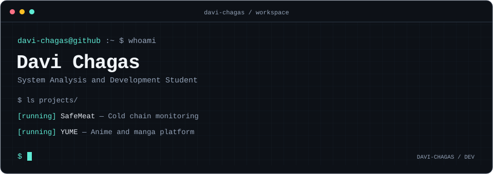

### 🧰 `~/stack`

### 🎓 `~/education`

**Academic Background**
- **System Analysis and Development** — SPTech (2026–2028)
- **Technical Degree in Systems Development** — SENAI (2024–2025)

**Certifications**
- **AWS Academy — Cloud Security Foundations** (2026)

### ✉️ `~/contact`

  

